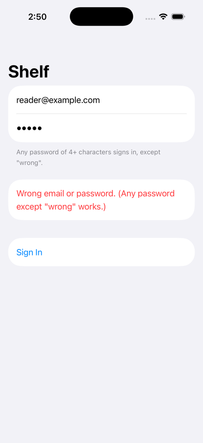
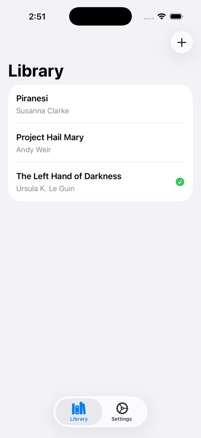
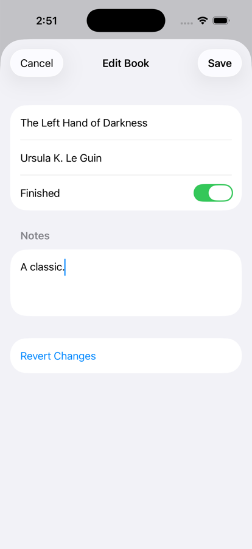
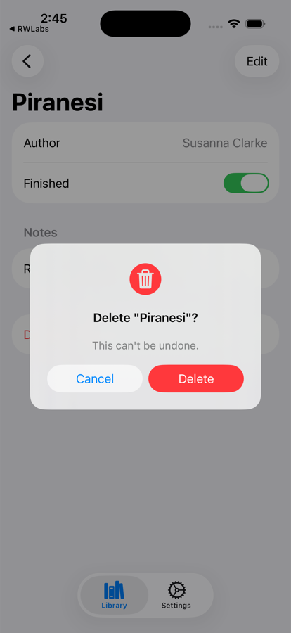

# Shelf: an example app

A small reading-list app built with RWLabsArchitecture. Every screen is a `@Component` model plus a `ComponentView`, and each one shows a different part of the library.

<p>
  
  
  
  
</p>

## Running it

1. Open `Examples/RWLabsDemo.xcodeproj` in Xcode. The project uses the package in this repository (`..`), so changes to the library show up straight away.
2. Pick the **RWLabsDemo** scheme and an iOS 17+ simulator, then run.
3. The first build stops with a prompt about the package's macros. Click **Trust & Enable**, then build again.

From the command line, `-skipMacroValidation` stands in for that prompt:

```bash
xcodebuild -project Examples/RWLabsDemo.xcodeproj -scheme RWLabsDemo -destination 'platform=iOS Simulator,name=iPhone 17' -skipMacroValidation build
```

Sign in with any password of four or more characters. The password `wrong` shows the error path. Books are kept in memory, so every launch starts with the same three.

## What each screen shows

| Screen | File | What to look at |
|---|---|---|
| App root | [`App/AppModel.swift`](RWLabsDemo/App/AppModel.swift) | A root flow: `state.flow` is `.login` or `.main`, each with a case connection. A deep link that arrives before sign-in waits in `pendingLink` and opens once the tab bar exists. |
| App setup | [`App/DemoApp.swift`](RWLabsDemo/App/DemoApp.swift) | `AppCoordinator.onConfigure` registers the `ErrorService` and the other services before the first model is created. `.onOpenURL` hands links to the root model. |
| Login | [`Features/Login/Login.swift`](RWLabsDemo/Features/Login/Login.swift) | `ValidationService` rules, `perform { }` for async work (it drives `isLoading` and `error`), and an output (`.signedIn`) to the parent. |
| Tab bar | [`Features/MainTab/MainTab.swift`](RWLabsDemo/Features/MainTab/MainTab.swift) | Every tab's state lives in the tab bar's state, wired with direct connections, so tabs keep their navigation while you switch. It adopts `DeepLinkStepHandler` to pick a tab for a link. |
| Library | [`Features/Library/Library.swift`](RWLabsDemo/Features/Library/Library.swift) | A list that pushes the detail screen (`.push`) and presents an editor sheet for a new book (`.present`). Its `Destination` is `@DeepLinkable`, and `@DeepLink("book", params: ["id": "bookID"])` maps `?id=` onto the detail's state. |
| Book detail | [`Features/BookDetail/BookDetail.swift`](RWLabsDemo/Features/BookDetail/BookDetail.swift) | Loads by id, so a link can open it. Presents the editor, confirms deletion in a `customAlert`, and leaves with `close()`, which pops it without an output. |
| Book editor | [`Features/BookEditor/BookEditor.swift`](RWLabsDemo/Features/BookEditor/BookEditor.swift) | `ItemEditingState` and `Editable`: fields bind to the draft, Save is enabled only when something changed, Revert restores the original, and saving commits what the store returned. |
| Settings | [`Features/Settings/Settings.swift`](RWLabsDemo/Features/Settings/Settings.swift) | Sign-out is an output that travels settings → tab bar → app, where the root switches back to login. It also has buttons that open the deep links below. |

The services the models inject (a book store, a sign-in service, an error service) are in [`Services/Services.swift`](RWLabsDemo/Services/Services.swift).

## Deep links

The app registers the `rwlabsdemo` URL scheme in `Examples/Info.plist`. With the app installed in a booted simulator:

```bash
xcrun simctl openurl booted "rwlabsdemo://library/book?id=2"
```

`library` selects the Library tab and `book?id=2` pushes that book. Opened before signing in, the link waits and opens after sign-in. `id=99` opens the detail screen with a "Couldn't open the book" message.

## Swift settings

The target uses Swift 6 language mode without MainActor default isolation, so views conform with `struct LoginView: @MainActor ComponentView`, and the services used inside `perform { }` are `Sendable`.
